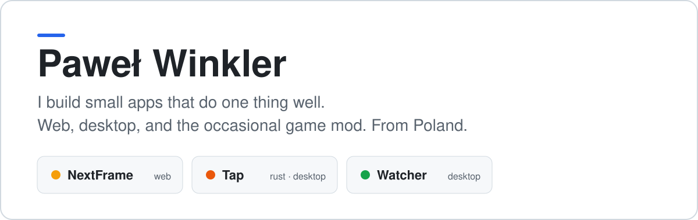

<a href="https://tracker.wajcha.dev">
  <picture>
    <source media="(prefers-color-scheme: dark)" srcset="https://raw.githubusercontent.com/PawWin/PawWin/main/assets/hero-dark.svg">
    <source media="(prefers-color-scheme: light)" srcset="https://raw.githubusercontent.com/PawWin/PawWin/main/assets/hero-light.svg">
    
  </picture>
</a>

[Email](mailto:winkler.pawel22@gmail.com) · [LinkedIn](https://linkedin.com/in/pawel-winkler)
