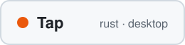
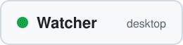

<picture>
  <source media="(prefers-color-scheme: dark)" srcset="https://raw.githubusercontent.com/PawWin/PawWin/main/assets/hero-dark.svg">
  <source media="(prefers-color-scheme: light)" srcset="https://raw.githubusercontent.com/PawWin/PawWin/main/assets/hero-light.svg">
  
</picture>

<a href="https://tracker.wajcha.dev"><picture>
  <source media="(prefers-color-scheme: dark)" srcset="https://raw.githubusercontent.com/PawWin/PawWin/main/assets/card-nextframe-dark.svg">
  
</picture></a>
<a href="https://github.com/PawWin/autoclicker"><picture>
  <source media="(prefers-color-scheme: dark)" srcset="https://raw.githubusercontent.com/PawWin/PawWin/main/assets/card-tap-dark.svg">
  
</picture></a>
<a href="https://github.com/PawWin/watcher-releases"><picture>
  <source media="(prefers-color-scheme: dark)" srcset="https://raw.githubusercontent.com/PawWin/PawWin/main/assets/card-watcher-dark.svg">
  
</picture></a>

[Email](mailto:winkler.pawel22@gmail.com) · [LinkedIn](https://linkedin.com/in/pawel-winkler)
